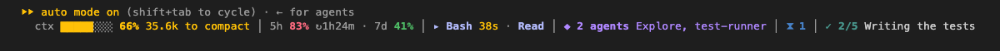
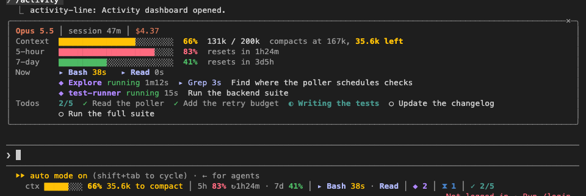

# activity-line

A Claude Code plugin that shows what your session is doing and how much room it has left. It adds one colour-coded row under the prompt that is always visible, plus an `/activity` dashboard for more detail.



From left to right:
- **Context**: how full the window is and how many tokens are left before auto-compaction.
- **Rate limits**: how much of each window you've used, and when it resets.
- **Running tools**: each with its elapsed time.
- **Subagents** that are running.
- **Background shells.**
- **Todo progress**, with the item in progress.

When the row is wider than the terminal, parts shorten and then drop out.



`/activity` opens the dashboard, which gives each figure its own row:
- The model, how long the session has run, and its cost.
- Meters for the context window and each rate-limit window. The context row also says where auto-compaction runs and how much room is left.
- What fills the context, as `/context` counts it.
- Every running tool, each agent with its status, age and the tool it's running now, and each background shell.
- The whole todo list.

## What the colours mean

| Part | Green | Yellow | Red |
| --- | --- | --- | --- |
| Context | under 70% of the auto-compact point | 70% and over | 90% and over, or "compacts next turn" |
| Rate-limit windows (5-hour, 7-day, spend) | under 50% | 50% and over | 80% and over |
| Elapsed time of a running tool | | 30 seconds and over | 2 minutes and over |

Context is measured against the point where Claude Code auto-compacts, not just the window. That's the limit you actually hit. When auto-compaction is off, it's measured against the window.

Tools are light blue, agents purple, background shells blue, the todo in progress teal, and model and cost Claude orange. Every colour comes from the active Claude Code theme, so the row reads correctly in light, dark, colour-blind and ANSI-only themes. Its symbols (`▸ ◆ ⧗ ✓ ↻`) are never drawn as emoji, so the row's width stays exact in every terminal.

## How it saves space

- The row sits beneath Claude Code's own hint row and leaves that row as it is, so mode indicators and shortcuts keep working.
- Every part has a full form and a short form. As the terminal narrows, parts switch to their short form, least important first; cost and model have no short form and drop out instead. If the row is still too wide, parts drop out in the same order: rate limits, background, todos, agents, then tools. Context always stays.
- Rate limits rank by how close they are. Under 50% they're the first to go. From 50% they stay longer than background work. At 80% or more they rank second only to the context, so they stay visible on a narrow terminal.
- Running tools, agents, background work and todos only appear while there are some. An idle session shows the context, your rate limits, the model and the cost.
- Widths are measured in terminal cells, so wide characters (Chinese, Japanese, Korean text, emoji) in a todo or a command can't push the row past the edge.
- The dashboard fits the rows its pane has. On a short pane the context breakdown gives way first, then the extra rows of running work, then the header. Context, limits, the first running row and the todos always stay.

## Where the figures come from

| Figure | Source | Updated |
| --- | --- | --- |
| Context tokens and % | the last API response's input tokens (uncached + cache written + cache read), the same figure as Claude Code's status line | read every second, so it moves within a turn |
| Auto-compact point, model, context breakdown | Claude Code's `/context` accounting (estimated locally) | at session start, when the context changes and after each turn; at most every 15 s, a later request waiting rather than being dropped |
| Rate limits and reset times | the rate-limit headers of the last API response (Claude subscriptions only); resets shown to the minute, rounded up | read every second |
| Cost | the session's running total, as `/cost` shows it | read every second |
| Running tools | from the moment a call starts until its result returns, including calls inside subagents | live, every second |
| Agents | the session's subagents and teammates that are pending, running or waiting | every second |
| Background shells and monitors | added the moment one starts (asked for, ctrl+b, or a shell that ran past its timeout), removed when stopped, and reconciled with Claude Code's own list at the end of every turn | live |
| Todos | the main conversation's latest todo-list update | live |

`/clear` and `/resume` start the figures over for the new conversation. A plugin reload keeps them, agents' ages included.

The plugin only reads. It never blocks or changes a tool call; if it fails while watching one, the call goes ahead untouched.

## Install

At the prompt of a terminal Claude Code session:

```
/plugin install activity-line --marketplace sarthakkhandelwal1999/claude-activity-line
```

Answer `y` to add the marketplace, then choose the **user** scope so it runs in every project. It starts working in that session.

From the command line instead:

```sh
claude plugin marketplace add sarthakkhandelwal1999/claude-activity-line
claude plugin install activity-line@activity-line --scope user
```

From a local clone (Claude Code reads it straight from the folder; run `/reload-plugins` after editing it):

```sh
claude plugin marketplace add /path/to/claude-activity-line
claude plugin install activity-line@activity-line --scope user
```

## In VS Code

- **The integrated terminal** (`claude` in a terminal tab) shows the colour row under the prompt, exactly as above. VS Code's terminal is xterm.js, the renderer these screenshots were taken with.
- **The Claude Code panel** has no row under its prompt. There the plugin opens the dashboard on its own as soon as the panel connects, and also shows the line as plain status text. `/activity` reopens the dashboard at any time.

## Settings

The settings are in `/config`, under the plugin, or in `settings.json` under `pluginConfigs`:

| Setting | Values | Default |
| --- | --- | --- |
| `placement` | `below`: under the prompt. `above`: the band above the prompt. `pane-only`: no row; use `/activity`. | `below` |
| `openPane` | `auto`: open the dashboard at start only where there is no row (the VS Code panel, mobile). `always`. `never`. | `auto` |

## Development

```sh
claude plugin validate .
claude plugin test .
ACTIVITY_LINE_DEMO=1 claude --plugin-dir .   # a busy demo session, for layout work and screenshots
```

| File | What it does |
| --- | --- |
| `hooks/model.ts` | Formatting, the colour rules, and fitting the line to a width. No engine calls. |
| `hooks/draw.tsx` | Draws the line and the dashboard from a snapshot. |
| `hooks/register.tsx` | Collects the figures from Claude Code's events and wires up the drawing sites. |
| `hooks/demo.ts` | The demo session. |
| `types/index.d.ts` | The snapshot's shape, the one piece of session state the plugin keeps. |

## Licence

MIT
